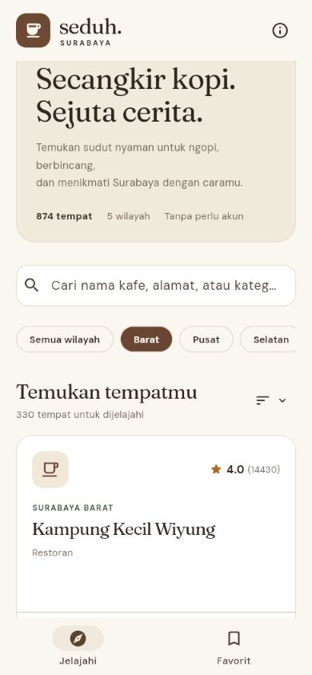
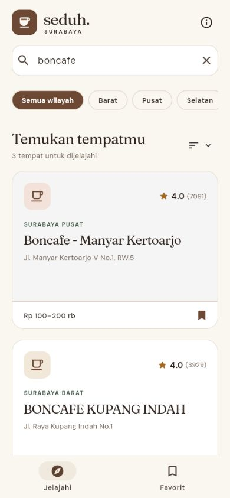
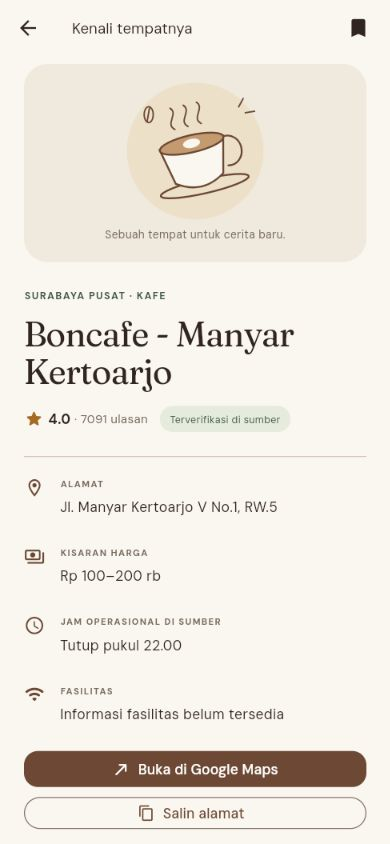

# LAPORAN UTS PEMROGRAMAN MOBILE

**Seduh Surabaya: Aplikasi Pencarian Kafe Berbasis Flutter dan REST API**

Identitas cover diambil dari `identitas.json`. Nama, NIM, kelas, jurusan, fakultas, perguruan tinggi, dan logo wajib dilengkapi sebelum laporan dikumpulkan. Naskah ini disusun berdasarkan implementasi dan pengujian pada 19 Oktober 2026.

# BAB I. PENDAHULUAN

## 1.1 Latar Belakang dan Gambaran Aplikasi

Surabaya memiliki banyak kafe dan tempat makan dengan lokasi, kategori, harga, serta jam operasional yang beragam. Pengguna membutuhkan cara ringkas untuk menemukan tempat, mempersempit pilihan berdasarkan wilayah, dan menyimpan tempat yang ingin dikunjungi. Data yang tersebar perlu disajikan dalam antarmuka yang mudah dipahami, termasuk ketika sebagian atribut belum tersedia.

Seduh Surabaya dikembangkan menggunakan Flutter dan bahasa Dart. Aplikasi memanfaatkan Surabaya Cafe API sebagai penyedia data. Sasaran pengguna adalah mahasiswa, pekerja, dan masyarakat yang ingin mencari tempat untuk berkunjung di Surabaya. Aplikasi memiliki halaman jelajah, koleksi favorit, serta halaman detail kafe. Pengguna tidak perlu membuat akun.

Tujuan pengembangan adalah menerapkan pengambilan data melalui HTTP, konversi JSON menjadi objek Dart, asynchronous programming dengan async/await dan FutureBuilder, serta penyajian data dinamis melalui GUI. Source code dipisahkan menjadi model, service API, penyimpanan favorit, halaman, dan komponen tampilan agar mudah dipahami dan dipelihara.

Pada pengecekan tanggal 19 Oktober 2026, endpoint daftar mengembalikan 874 entri yang tersebar di lima wilayah Surabaya. Angka ini merupakan hasil observasi pada waktu pengujian dan dapat berubah. Dataset mencakup kafe serta sejumlah restoran atau tempat makan; aplikasi mempertahankan nama dan kategori dari API tanpa menganggap seluruh entri sebagai kedai kopi.

## 1.2 Fitur Aplikasi

| Fitur | Fungsi dan manfaat |
| --- | --- |
| Jelajah tempat | Menampilkan nama, wilayah, rating, jumlah ulasan, alamat, dan harga dari API. |
| Pencarian | Menemukan entri berdasarkan nama, alamat, kategori, atau wilayah tanpa membedakan kapitalisasi. |
| Filter wilayah | Membatasi hasil ke Surabaya Barat, Pusat, Selatan, Timur, atau Utara. |
| Pengurutan | Mengurutkan seluruh hasil berdasarkan jumlah ulasan, rating tertinggi, atau nama A-Z. |
| Detail kafe | Mengambil detail berdasarkan ID dan menampilkan informasi tempat yang lebih lengkap. |
| Favorit | Menyimpan ID tempat pada perangkat melalui shared_preferences; dapat ditambah dan dihapus. |
| Google Maps | Membuka tautan lokasi yang valid; memakai koordinat sebagai fallback bila tersedia. |
| Salin alamat | Menyalin nama, alamat, dan wilayah ke clipboard perangkat. |
| Muat ulang | Meminta ulang data melalui ikon refresh atau gerakan tarik ke bawah. |
| Umpan balik kondisi | Menyediakan loading, sukses, error dengan retry, data kosong, dan hasil pencarian kosong. |

# BAB II. PEMBAHASAN

## 2.1 Persiapan Project dan Package

Project dibuat dengan Flutter SDK 3.47.7 dan Dart SDK 3.13.5. Target yang disiapkan adalah Android dan web. Android menggunakan application ID id.ac.kampus.seduh_surabaya. Permission android.permission.INTERNET ditambahkan pada manifest utama sehingga koneksi HTTPS juga tersedia pada build release.

```bash
flutter create --platforms=android,web \
  --org=id.ac.kampus --project-name=seduh_surabaya seduh_surabaya
cd seduh_surabaya
flutter pub get
flutter run
```

Package tambahan digunakan sesuai kebutuhan. Versi terselesaikan dan dependensi transitif dicatat dalam pubspec.lock sehingga lingkungan pengembangan dapat direproduksi.

| Package | Versi langsung | Alasan penggunaan |
| --- | --- | --- |
| http | 1.6.0 | GET HTTPS, respons status dan body; MockClient memudahkan pengujian jaringan. |
| shared_preferences | 2.5.6 | Menyimpan daftar ID favorit sebagai list string pada perangkat. |
| url_launcher | 6.3.3 | Membuka Google Maps melalui aplikasi atau browser eksternal. |
| flutter_test | SDK Flutter | Pengujian model, service, filter, penyimpanan, dan interaksi widget. |
| flutter_lints | 6.0.0 | Memeriksa kode melalui flutter analyze. |

Struktur folder utama sebagai berikut. Berkas main.dart menginisialisasi Flutter dan penyimpanan. app.dart membangun MaterialApp, sedangkan theme.dart mengatur palet dan tipografi.

```text
lib/
  main.dart
  app.dart
  theme.dart
  models/
    cafe.dart
    cafe_filter.dart
  services/
    cafe_api.dart
  state/
    favorites_store.dart
  screens/
    explore_screen.dart
    detail_screen.dart
  widgets/
    cafe_card.dart
    coffee_art.dart
    feedback_panel.dart
```

Class Cafe mewakili data tempat. CafeApi menangani komunikasi jaringan. FavoritesStore menggunakan ChangeNotifier untuk mengabarkan perubahan favorit. ExploreScreen dan DetailScreen menggunakan FutureBuilder masing-masing. Komponen kartu dan panel kondisi dipisahkan agar dapat digunakan secara konsisten.

## 2.2 Desain Antarmuka Pengguna (User Interface)

Antarmuka menggunakan warna krem sebagai latar, cokelat sebagai warna aksi, dan hijau sebagai aksen wilayah. DM Sans digunakan untuk teks antarmuka dan Fraunces untuk judul. Font dibundel sebagai aset lokal sehingga pemuatan font tidak bergantung pada layanan font eksternal. Ilustrasi cangkir dibuat dengan CustomPainter dan tidak diklaim sebagai foto kafe.

Halaman jelajah menampilkan identitas aplikasi, pengantar, jumlah tempat dan wilayah, kolom pencarian, pilihan wilayah, pengurutan, serta kartu tempat. Pada layar kecil digunakan satu kolom dan navigasi bawah. Layar lebih lebar menggunakan dua atau tiga kolom dan navigasi pada bagian atas. Daftar menggunakan SliverGrid dengan jumlah tampilan awal 24 kartu; tombol Tampilkan lagi menambah 24 kartu berikutnya.



Pencarian dan filter ditempatkan sebelum daftar agar pengguna dapat mempersempit hasil dengan cepat. Hasil pencarian menampilkan jumlah entri yang cocok. Ketika tidak ada hasil, aplikasi menawarkan reset pencarian. Tombol penanda pada setiap kartu menyimpan atau menghapus favorit.



Halaman detail mengambil ulang data tempat berdasarkan ID. Informasi yang disajikan meliputi wilayah, kategori, rating dan jumlah ulasan, alamat, kisaran harga, jam operasional, fasilitas, dan tanggal verifikasi sumber jika tersedia. Aksi Google Maps dan salin alamat berada setelah informasi utama.



Halaman favorit menggunakan data API yang sama dan menyaringnya dengan ID yang tersimpan lokal. Saat favorit kosong, aplikasi menjelaskan cara menyimpan tempat dan menyediakan tombol kembali menjelajah. Favorit tetap tersimpan setelah aplikasi atau browser dimuat ulang, tetapi daftar dan detail masih memerlukan koneksi API.

Ikon penanda yang terisi pada Gambar 2 dan Gambar 3 menunjukkan bahwa tempat telah disimpan sebagai favorit. Alur halaman favorit juga diverifikasi melalui widget test pada lebar ponsel.

Screenshot pada laporan berasal dari build Flutter web dengan viewport ponsel 390 x 844. Screenshot tersebut mendokumentasikan tampilan aplikasi yang dijalankan; bukan gambar rancangan dan bukan bukti uji runtime emulator Android. Tampilan desktop tambahan tersedia pada folder docs/screenshots.

## 2.3 Implementasi Pengambilan dan Pengolahan Data dari API

### 2.3.1 URL API dan struktur respons

Base URL yang digunakan adalah https://surabaya-cafe-api.vercel.app. Aplikasi memakai dua endpoint utama:

| Method dan endpoint | Kegunaan |
| --- | --- |
| GET /api/cafes?limit=1000&page=1 | Mengambil daftar dan metadata pagination. |
| GET /api/cafes/{id} | Mengambil satu objek tempat berdasarkan ID. |

Respons daftar berbentuk objek yang memiliki success, total_data, page, limit, total_pages, dan data. Field data berisi array objek. Respons detail langsung berupa satu objek tempat, tanpa envelope data. Perbedaan struktur tersebut ditangani dalam dua metode service yang terpisah.

Contoh ringkas berikut diambil dari struktur respons aktual, dengan atribut yang tidak dipakai pada penjelasan dihilangkan. Respons lengkap contoh tersedia dalam test/fixtures/cafes.json dan test/fixtures/detail.json.

```json
{
  "success": true,
  "total_data": 874,
  "page": 1,
  "limit": 2,
  "total_pages": 437,
  "data": [{
    "id": 428173890,
    "name": "Kollabora ...",
    "area": "Surabaya Barat",
    "category": "Kedai Kopi",
    "price_range": "Rp 50-150 rb",
    "gmaps_rating": 4,
    "gmaps_review_count": 1668
  }]
}
```

Nama dan penulisan harga pada contoh di atas disingkat untuk penjelasan. Aplikasi menampilkan nilai asli API, bukan teks contoh tersebut. Tidak semua atribut ditampilkan karena tugas memperbolehkan pemilihan atribut yang relevan.

### 2.3.2 Pengiriman permintaan HTTP dan pemeriksaan respons

CafeApi menerima http.Client melalui constructor. Pada pemakaian normal digunakan client jaringan; pada pengujian digunakan MockClient. Metode _get mengirim permintaan GET dengan header Accept application/json, membatasi waktu tunggu 20 detik, memeriksa status HTTP 200, kemudian mendekode body sebagai UTF-8 dan JSON.

```dart
final response = await _client.get(
  uri,
  headers: {'Accept': 'application/json'},
).timeout(timeout);
if (response.statusCode != 200) {
  throw CafeApiException(
    'Server sedang bermasalah (HTTP ${response.statusCode}). Coba lagi.',
  );
}
return jsonDecode(utf8.decode(response.bodyBytes));
```

Potongan kode menyederhanakan cabang pesan khusus HTTP 404; implementasi lengkap membedakan kafe tidak ditemukan dari gangguan server lain. TimeoutException, http.ClientException, dan FormatException diubah menjadi CafeApiException dengan pesan bahasa Indonesia. Dengan demikian, pengguna memperoleh pesan yang dapat dipahami tanpa menampilkan stack trace.

Service daftar memvalidasi success == true dan bahwa data berbentuk List. Setiap elemen harus berupa Map dan dapat dikonversi menjadi Cafe. Apabila satu baris tidak valid, service melaporkan error daripada diam-diam membuangnya. Jika total_pages lebih dari satu, service mengambil halaman berikutnya. Batas defensif 100 halaman mencegah loop tidak terkendali akibat metadata server yang tidak wajar.

### 2.3.3 Konversi JSON menjadi objek Dart

Model Cafe menyimpan id, name, area, category, address, priceRange, openingHours, description, rating, reviewCount, koordinat, mapsUrl, status verified, tanggal verifikasi, fasilitas, dan tag. ID serta nama merupakan atribut wajib. Field opsional yang hilang tidak membuat layar gagal.

```dart
factory Cafe.fromJson(Map<String, dynamic> json) {
  final id = int.tryParse('${json['id']}');
  final name = _text(json['name']);
  if (id == null || name.isEmpty) {
    throw const FormatException('Identitas kafe tidak valid.');
  }
  final rating = _number(json['gmaps_rating']);
  return Cafe(
    id: id,
    name: name,
    area: _text(json['area']),
    address: _text(json['address']),
    priceRange: _text(json['price_range']),
    rating: rating != null && rating > 0 && rating <= 5
        ? rating : null,
    // Atribut lain dipetakan pada implementasi lengkap.
  );
}
```

Field numerik diterima dari JSON number atau string numerik. Rating di luar rentang lebih dari 0 sampai 5 dianggap tidak tersedia. Teks null atau bukan string diubah menjadi string kosong. Getter displayPrice, displayAddress, dan displayHours menghasilkan keterangan belum tersedia saat field kosong. Fasilitas kosong tidak diartikan sebagai tidak ada fasilitas, melainkan informasi yang belum disediakan oleh sumber.

### 2.3.4 Asynchronous programming dan FutureBuilder

Permintaan HTTP mengembalikan Future. Proses jaringan ditangani menggunakan async/await agar antarmuka tetap merespons. Future daftar dibuat sekali pada initState dan disimpan pada variabel _future. Future tidak dibuat di build, sehingga mengetik kata kunci, mengganti wilayah, atau menyimpan favorit tidak memulai ulang permintaan HTTP.

```dart
@override
void initState() {
  super.initState();
  _future = widget.api.fetchCafes();
}
```

ExploreScreen menggunakan FutureBuilder<List<Cafe>>. Saat snapshot.connectionState bernilai waiting, ditampilkan indikator loading. Saat snapshot.hasError bernilai true, panel error menampilkan pesan serta tombol Coba lagi. Saat berhasil, data diproses untuk pencarian dan ditampilkan melalui kartu. Respons berhasil dengan array kosong memperoleh panel kosong yang berbeda dari error.

```dart
FutureBuilder<List<Cafe>>(
  future: _future,
  builder: (context, snapshot) {
    // Implementasi asli membangun bagian-bagian ini sebagai sliver.
    if (snapshot.connectionState == ConnectionState.waiting) {
      return const LoadingPanel();
    }
    if (snapshot.hasError) {
      return FeedbackPanel(
        icon: Icons.wifi_off_rounded,
        title: 'Kopi boleh jeda. Koneksi juga.',
        message: '${snapshot.error}',
        action: _reload,
      );
    }
    // Hasil sukses ditampilkan dengan SliverGrid pada layar asli.
    return buildCafeResults(snapshot.data ?? []);
  },
)
```

Potongan terakhir merupakan ringkasan alur, bukan widget pengganti yang dapat ditempel langsung: buildCafeResults adalah nama ilustratif untuk bagian penyajian SliverGrid pada ExploreScreen. Implementasi utuh pada source code menggunakan sliver dan menyediakan penanganan kondisi kosong. Pada DetailScreen, pola yang sama diterapkan menggunakan FutureBuilder<Cafe> dengan endpoint detail.

Refresh dan retry mengganti _future dengan pemanggilan baru. RefreshIndicator menunggu Future selesai; kegagalan ditampilkan oleh FutureBuilder. Pada detail, kegagalan endpoint 404 atau koneksi menampilkan panel error dan tombol retry.

### 2.3.5 Pencarian, pengurutan, dan penyajian data

Daftar lengkap diambil terlebih dahulu. Fungsi filterCafes menyaring data berdasarkan semua kata pada kata kunci, wilayah terpilih, dan ID favorit bila halaman favorit aktif. Pencarian mencakup nama, alamat, kategori, serta wilayah. Setiap kata wajib ditemukan dalam gabungan atribut tersebut. Pengurutan popular menggunakan jumlah ulasan; rating menggunakan nilai rating menurun, sedangkan nama menggunakan urutan alfabet. Jumlah ulasan tidak disebut sebagai rekomendasi kualitas.

Penyaringan dilakukan pada client setelah data diperoleh dari API. Ini memberikan respons cepat dan memungkinkan kombinasi filter tanpa mengirim HTTP pada setiap perubahan teks. Pembatasan awal 24 kartu hanya mengatur jumlah widget yang dirender, bukan jumlah data yang dicari. Jika dataset jauh lebih besar, pagination dan filter server dapat digunakan pada pengembangan berikutnya.

```dart
final results = filterCafes(
  all,
  query: _search.text,
  area: _area,
  favoriteIds: _favoritesOnly ? widget.favorites.ids : null,
  sort: _sort,
);
```

FavoritesStore menyimpan hanya ID dalam daftar string. Perubahan baru diterapkan setelah setStringList berhasil. Penyimpanan yang tidak tersedia atau gagal menghasilkan pesan kegagalan sehingga antarmuka tidak mengklaim favorit sudah tersimpan. Perubahan state diberitahukan melalui ChangeNotifier dan dirender melalui ListenableBuilder.

Tautan Google Maps divalidasi agar menggunakan HTTPS dengan host google.com atau www.google.com dan path /maps. Jika tautan tidak memenuhi ketentuan tetapi koordinat valid, aplikasi membuat URL pencarian Google Maps dari koordinat. Bila keduanya tidak tersedia, tombol Maps dinonaktifkan. Tombol salin alamat memakai Clipboard.setData dan menangani kegagalan platform.

### 2.3.6 Penanganan kondisi aplikasi

| Kondisi | Respons aplikasi |
| --- | --- |
| Permintaan masih berjalan | Indikator progres dan pesan pemuatan data. |
| HTTP 200 dan data valid | Konversi model, filter/sort, lalu tampilkan daftar atau detail. |
| HTTP 404 | Pesan kafe tidak ditemukan dan pilihan mencoba kembali. |
| HTTP 429 atau 500 | Pesan status gangguan dan retry. |
| Tidak terhubung / timeout | Pesan periksa koneksi atau waktu tunggu terlalu lama. |
| JSON atau skema rusak | Pesan data server tidak valid; tidak memalsukan hasil sukses. |
| Respons daftar kosong | Panel daftar belum tersedia dan tombol muat ulang. |
| Hasil filter/pencarian kosong | Panel belum ada yang cocok dan reset pencarian. |
| Favorit belum ada | Petunjuk menyimpan tempat dan tombol jelajahi. |
| Atribut opsional kosong | Keterangan belum tersedia, bukan data buatan. |

### 2.3.7 Pengujian aplikasi dan hasil

Pengujian dilakukan pada tiga tingkat: unit test untuk parsing, jaringan, filter, dan penyimpanan; widget test untuk alur antarmuka; serta pemeriksaan API dan aplikasi web release secara langsung. MockClient mengendalikan respons agar timeout, HTTP gagal, serta JSON rusak dapat diuji tanpa bergantung pada kondisi layanan eksternal.

| Kelompok | Jumlah | Cakupan utama | Hasil |
| --- | --- | --- | --- |
| cafe_api_test.dart | 16 | Envelope, Unicode, pagination, detail, 404/429/500, JSON/skema rusak, timeout, koneksi gagal. | Lulus |
| models_and_favorites_test.dart | 10 | Fallback, model wajib, rating, pencarian gabungan, sort, URL Maps, persistensi dan gagal simpan. | Lulus |
| app_test.dart | 5 | Loading ke sukses, retry, daftar kosong, filter/favorit/detail pada lebar ponsel, reset pencarian. | Lulus |
| Total | 31 | Pengujian unit dan widget. | Lulus |

Perintah flutter test --reporter expanded menghasilkan 31 pengujian lulus. flutter analyze menghasilkan No issues found. Bukti log disertakan pada docs/pengujian-otomatis.txt dan docs/analisis-statis.txt. Widget test memuat font yang sama dengan aplikasi agar pemeriksaan tata letak lebih representatif.

| Pemeriksaan langsung | Hasil observasi |
| --- | --- |
| GET daftar melalui service Dart | 874 entri dari lima wilayah diterima. |
| GET detail melalui service Dart | Objek detail berhasil dikonversi dan URL Maps valid. |
| Daftar pada Flutter web | Data aktual tampil pada antarmuka. |
| Pencarian boncafe | Tiga hasil ditemukan pada waktu pengujian. |
| Filter Barat | 330 entri ditemukan tanpa kata kunci. |
| Simpan favorit dan kembali | Ikon/status berubah; navigasi kembali mempertahankan keadaan daftar. |
| Build Android ARM64 release | Berhasil menghasilkan app-release.apk. |
| Build web release | Berhasil menghasilkan folder build/web. |

Lingkungan pengujian menggunakan Flutter 3.47.7, Dart 3.13.5, dan browser desktop dengan viewport ponsel 390 x 844 serta viewport desktop. Paket APK ARM64 berukuran sekitar 19 MB. APK menggunakan debug signing untuk pengujian tugas. Angka ukuran dapat sedikit berubah jika source atau build berubah.

Keterbatasan verifikasi: tidak tersedia perangkat Android fisik yang terhubung, sehingga keberhasilan build APK bukan bukti uji runtime di ponsel. Pembukaan aplikasi Google Maps eksternal serta clipboard sistem Android tetap perlu diuji pada perangkat. Data harga, jam operasional, dan alamat mengikuti snapshot penyedia API; aplikasi tidak menghitung apakah tempat sedang buka berdasarkan waktu saat ini.

# BAB III. PENUTUP

## 3.1 Kesimpulan

Seduh Surabaya telah mengimplementasikan aplikasi Flutter dan Dart yang menyajikan data dinamis dari Surabaya Cafe API. Proses HTTP, pemeriksaan status, decoding JSON, konversi menjadi class model, serta penyajian melalui antarmuka telah diterapkan. FutureBuilder menangani loading, sukses, dan error pada daftar serta detail. Pengguna dapat mencari, menyaring, mengurutkan, menyimpan favorit, membuka tautan lokasi, dan menyalin alamat.

Hasil pengujian menunjukkan 31 tes unit/widget lulus, analisis statis tanpa masalah, serta build web dan Android ARM64 berhasil. Pemeriksaan web dengan API langsung mengonfirmasi daftar, pencarian, filter, favorit, dan detail bekerja pada skenario yang diuji. Berdasarkan hasil tersebut, tujuan implementasi dan verifikasi yang tersedia telah tercapai. Pengujian runtime Android pada perangkat fisik masih diperlukan sebelum menyatakan seluruh fungsi platform telah terverifikasi.

## 3.2 Saran

Pengembangan selanjutnya dapat menambahkan pagination server untuk dataset yang lebih besar, cache daftar untuk penggunaan terbatas saat offline, dan sinkronisasi favorit antarperangkat. Fasilitas atau foto tempat dapat ditambahkan bila sumber API menyediakan data yang jelas. Jam operasional terstruktur diperlukan bila aplikasi ingin menghitung status buka saat ini secara andal.

Pengujian lanjutan sebaiknya dilakukan pada beberapa ukuran perangkat Android, keadaan jaringan lambat dan terputus, penyimpanan terbatas, serta pembukaan Google Maps dan clipboard. Cover laporan dan identitas repositori perlu disesuaikan dengan mahasiswa sebelum pengumpulan. PDF akhir diunggah ke Google Drive dengan akses Anyone with the link sebagai Viewer dan diperiksa melalui jendela Incognito tanpa login.

# DAFTAR PUSTAKA

[1] Reyhandhani. Surabaya Cafe API: dokumentasi endpoint, struktur data, dan lisensi. https://surabaya-cafe-api.vercel.app/. Diakses 19 Oktober 2026.

[2] Flutter. Fetch data from the internet. https://docs.flutter.dev/cookbook/networking/fetch-data. Diakses 19 Oktober 2026.

[3] Flutter API. FutureBuilder class. https://api.flutter.dev/flutter/widgets/FutureBuilder-class.html. Diakses 19 Oktober 2026.

[4] Dart. Asynchronous programming: futures, async, await. https://dart.dev/libraries/async/async-await. Diakses 19 Oktober 2026.

[5] Dart package http. Dokumentasi package. https://pub.dev/packages/http. Diakses 19 Oktober 2026.

[6] Flutter package shared_preferences. Dokumentasi penyimpanan lokal. https://pub.dev/packages/shared_preferences. Diakses 19 Oktober 2026.

[7] Flutter package url_launcher. Dokumentasi pembukaan URL. https://pub.dev/packages/url_launcher. Diakses 19 Oktober 2026.

[8] Google Fonts. DM Sans dan Fraunces, SIL Open Font License. https://github.com/google/fonts/tree/main/ofl/dmsans dan https://github.com/google/fonts/tree/main/ofl/fraunces. Berkas lisensi disertakan dalam proyek.
